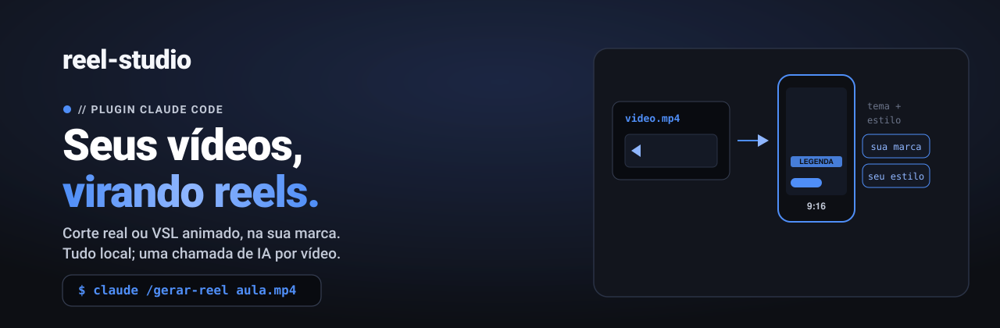

<p align="center">
  
</p>

<p align="center">
  <a href="https://github.com/nathanramorim/reel-studio/releases"></a>
  
  
  
  
  
  
</p>

<h3 align="center">Corte real ou VSL animado, na sua marca.<br>Tudo local; uma chamada de IA por vídeo.</h3>

---

## O que é

O **reel-studio** transforma um vídeo que você já gravou em um reel vertical para o Instagram. Dois modos: **corte**, que recorta o trecho real do vídeo, e **VSL**, que reescreve a fala como um roteiro curto e anima num dos estilos visuais.

A transcrição roda local (Whisper). O modelo de IA só vê o texto, nunca o vídeo nem o áudio. Dentro do Claude Code, é o próprio Claude que escolhe os cortes e escreve o roteiro — sem chave de API, sem chamada de rede extra. Fora do Claude Code, há um caminho de automação via OpenRouter. Nada é gerado sem você aprovar o corte ou o roteiro primeiro.

## Por que usar

| | |
|---|---|
| 🎬 **Dois modos** | Vídeo bom? Corta o real. Vídeo ou áudio ruim? Anima o roteiro. |
| 🔒 **Dados locais** | Mídia nunca sai da sua máquina; só texto compactado vai para a IA. |
| 🎨 **Sua marca** | Tema (cores, fonte, CTA) e estilo visual são independentes; combine como quiser. |
| 🧠 **Poucos tokens** | Cerca de 1 a 2 mil tokens por reel, numa chamada só. |
| 🧩 **Replicável** | Plugin do Claude Code: instala, usa o próprio tema, pronto. |

## Requisitos

> **Cole isto na sua IA antes de instalar:**
>
> "Verifique os requisitos do reel-studio. Se não tiver o `uv`, me pergunte e, com o meu ok, instale com `brew install uv` (ou `curl -LsSf https://astral.sh/uv/install.sh | sh`). Depois rode `uv run https://raw.githubusercontent.com/nathanramorim/reel-studio/main/scripts/requisitos.py checar`. Se faltar algo, me mostre a lista, peça o meu ok item a item e rode `uv run https://raw.githubusercontent.com/nathanramorim/reel-studio/main/scripts/requisitos.py instalar --sim <item>` só para cada item que eu aprovar. Não aceite licenças nem declarações por mim. Depois instale o plugin com `claude plugin marketplace add nathanramorim/reel-studio` e `claude plugin install reel-studio@reel-studio`, e faça o mesmo `checar` e `instalar --sim <item>` para os itens do motor."

O script é público e só usa o Python padrão: dá para rodar antes de clonar. `checar` mostra cada item como `ok`, `faltando` (obrigatório) ou `opcional`, com a versão e o comando que resolve (`--json` para máquina); sai com código 1 se faltar um obrigatório. `instalar <item>` cuida só dos itens que você nomear (sem nomes, de tudo o que falta); ele pergunta antes de cada comando (`--sim` roda sem perguntar, para a IA rodar o item que você já aprovou), pula o que já está ok, sai com código 1 se um comando falhar ou se o item pedido continuar faltando e **nunca** aceita licença nem lê chave: esses itens ele só explica. Os itens do motor (extras e `npm install`) só aparecem resolvíveis depois do plugin instalado ou do repositório clonado; num clone, rode `uv run scripts/requisitos.py checar` na pasta `reel-studio`.

| Ponto | O que precisa |
|---|---|
| **Onde roda** | Feito e testado no **macOS com Apple Silicon**. Linux e Windows não foram testados (o motor já dá a dica de `winget` no Windows). No Apple Silicon, use o terminal nativo (arm64): sob Rosetta, instale com `arch -arm64 brew ...` (o script já monta assim). Agentes: Claude Code (plugin), agy (Antigravity) e Codex (lêem a mesma skill); sem agente, a CLI funciona com o OpenRouter (veja "Contas e chaves"). |
| **Programas** | [`uv`](https://docs.astral.sh/uv/): `brew install uv` (ele instala o **Python 3.11** ou mais novo; você não usa `pip`). **ffmpeg com libass** (a legenda usa o filtro `ass`): `brew install ffmpeg-full` e, como ele é keg-only, `brew link --overwrite --force ffmpeg-full`; no Windows, `winget install ffmpeg`. **Node.js 18 ou mais novo**, só para o modo VSL e os componentes do corte: `brew install node`. O render usa **Remotion 4** (travado em 4.0.543 no `package-lock.json`). |
| **Extras do motor** (em `engine/`) | `transcribe` (faster-whisper, **obrigatório**): `uv sync --inexact --extra transcribe`. `voice` (demucs + PyTorch, só para isolar a voz com `--voice-only`): `uv sync --inexact --extra voice`. `vision` (OpenCV, só para o enquadramento automático do corte; sem ele o corte usa `fit`): `uv sync --inexact --extra vision`. O `--inexact` mantém os extras que você já tinha. |
| **Downloads na primeira execução** | Modelo do **Whisper** `small` (cerca de 480 MB; outro com `REEL_WHISPER_MODEL=medium` ou `large-v3`, maiores) em `~/.cache/huggingface/hub/`, baixado na primeira transcrição. Extra `voice`: PyTorch (cerca de 1 GB) no `.venv` e o modelo **htdemucs** (cerca de 80 MB) em `~/.cache/torch/hub/checkpoints/`, no primeiro `--voice-only`. Modo VSL: `npm install` em `render/` (cerca de 700 MB em `render/node_modules/`, o que inclui o **Chrome Headless Shell** do Remotion, cerca de 200 MB, em `render/node_modules/.remotion/`; ele baixa no primeiro render ou adiantado com `npx remotion browser ensure`). Depois disso tudo roda sem internet. |
| **Contas e chaves** | Nenhuma dentro do Claude Code, agy ou Codex: o próprio agente escreve os cortes e o roteiro. **Opcional:** para automação sem agente (`suggest` e `script`), uma chave do OpenRouter em `OPENROUTER_API_KEY` no `.env` (copie de `.env.example`; o `.env` fica fora do git). O script de requisitos não lê nem grava a chave. |
| **Máquina** | RAM: estimativa de 8 GB (não medido; a transcrição e o render rodam no seu computador). Reserve cerca de 3 GB de disco com os extras e o modo VSL (Whisper small ~480 MB, PyTorch ~1 GB, htdemucs ~80 MB, `node_modules` com o Chrome ~700 MB), mais o espaço dos vídeos. |
| **Licenças e limites** | Código MIT. faster-whisper e demucs: MIT. OpenCV: Apache 2.0. O **Remotion** é grátis para uso pessoal e para empresas de até 3 pessoas; acima disso, a empresa precisa da [licença paga](https://www.remotion.dev/license). Quem aceita é você: o script só mostra. |
| **O que você fornece** | O **vídeo** já gravado (ou o áudio, no modo VSL) e o **tema** com a sua marca (cores, fonte, legenda e CTA): copie `themes/exemplo.json` (veja a skill, referência "criar tema"). Você aprova os cortes ou o roteiro antes de qualquer vídeo ser gerado. |

## Instalação

### No Claude Code

```
/plugin marketplace add nathanramorim/reel-studio
/plugin install reel-studio@reel-studio
```

### No agy (Antigravity) ou Codex

```bash
git clone https://github.com/nathanramorim/reel-studio
cd reel-studio
cd engine && uv sync --extra transcribe
cd ../render && npm install   # só se for usar o modo VSL
```

Abra o agy ou o Codex **dentro da pasta `reel-studio`**: o agy encontra a skill em `.agents/skills/reel-studio/`, o Codex lê `AGENTS.md` na raiz. Os dois apontam para a mesma fonte, `skills/reel-studio/SKILL.md`.

## Como usar

No Claude Code, dentro de uma sessão com o plugin instalado:

```
/gerar-reel aula.mp4
```

A skill pergunta o modo, o tema e (no modo VSL) o estilo, mostra o plano e só gera o vídeo depois do seu "sim". Comandos extras: `/transcrever` e `/extrair-voz`.

No agy ou no Codex não há comando de barra: basta pedir em linguagem natural, ex. "gere um reel de aula.mp4 no modo corte, tema busize" — o agente lê a mesma skill e segue os mesmos passos.

Pela CLI, dentro de uma sessão com agente, em qualquer um dos três (sem chave de API — o agente lê o prompt e escreve o JSON):

```bash
cd engine
uv run reel-studio extract aula.mp4
uv run reel-studio transcribe aula.mp4   # --model medium ou large-v3 acerta mais o sotaque

uv run reel-studio prompt-suggest aula.mp4 --max 5    # modo corte: mostra o prompt
# o agente escreve cortes.json a partir do prompt
uv run reel-studio save-clips aula.mp4 --file cortes.json --max 5
uv run reel-studio cut aula.mp4 --theme busize
# com `overlays` no clips.json, o corte ganha uma camada de componentes (gancho, passos, CTA, logo);
# o mp4 do corte fica intacto e o resultado sai em clip-NN-TEMA-overlay.mp4. --overlays none ignora.

uv run reel-studio prompt-script aula.mp4 --style isometric-pastel   # modo VSL
# o agente escreve roteiro.json a partir do prompt
uv run reel-studio save-scenes aula.mp4 --style isometric-pastel --theme forge --file roteiro.json
uv run reel-studio render aula.mp4 --theme forge --style forge-motion   # --captions narration|none, --audio original|none
```

**`correcoes.json`** (opcional, ao lado do vídeo ou em `--glossary`): mapa `errado -> certo` aplicado à transcrição em memória. Uma chave aceita variantes separadas por `|` (`"checaja|checage|checajem": "checagem"`); a mesma variante com dois valores é erro. O tema pode ter `vocabulary` (lista de termos), que junto aos valores do glossário alimenta o prompt do Whisper (`transcribe --theme TEMA`, `--prompt` para texto extra). `save-clips` e `save-scenes` aceitam `--file` e `--style` ou os mesmos valores como argumentos posicionais.

Fora do Claude Code, para automação (CI, cron), use `suggest` e `script` no lugar de `prompt-suggest`/`save-clips` e `prompt-script`/`save-scenes`: eles chamam o OpenRouter direto, com `OPENROUTER_API_KEY` no `.env`.

## Temas e estilos

Tema é a sua marca (cores, fontes, legenda, CTA): qualquer pessoa cria o dela. `pessoal`, `busize` e `forge` são as minhas, incluídas como exemplo real; `exemplo` é o template genérico para copiar (veja a skill, referência "criar tema").

**Estilos disponíveis**, copiados do [AI Style Atlas](https://www.futurepedia.io/resources/ai-style-atlas/view) para não depender do site:

| Estilo | Bom para |
|---|---|
| Flat Vector Science | Conceitos e metáforas |
| Whiteboard Explainer | Raciocínio passo a passo |
| Isometric Pastel | Processos e fluxos |
| Manim Style Math | Números e fórmulas (render na fase 3) |

## Segurança e privacidade

- Vídeo e áudio **nunca** saem da sua máquina.
- Dentro do Claude Code, nem a transcrição sai: o próprio Claude lê o prompt e gera o JSON, sem chamada de rede nova.
- No caminho de automação (fora do Claude Code), só a transcrição compactada vai ao provedor que você escolher no OpenRouter.
- A chave de API, quando usada, fica em `.env`, fora do controle de versão.
- O Remotion tem licença gratuita para uso pessoal e empresas de até 3 pessoas; acima disso, [confira a licença](https://www.remotion.dev/license) antes de usar em produção.

## Versões

| Versão | Novidades |
|---|---|
| **0.2.0** | `scripts/requisitos.py` com `checar` e `instalar` (pergunta antes de instalar e nunca aceita licença por você), seção Requisitos completa e o prompt para colar na IA antes de instalar. Inclui as entregas 03 a 05 da `main` (veja `sdd/releases/history.md`). |
| **0.1.0** | Primeira versão: modo corte completo, modo VSL com 3 estilos SVG, 3 temas + exemplo, plugin do Claude Code. |

## Licença

[MIT](LICENSE)
