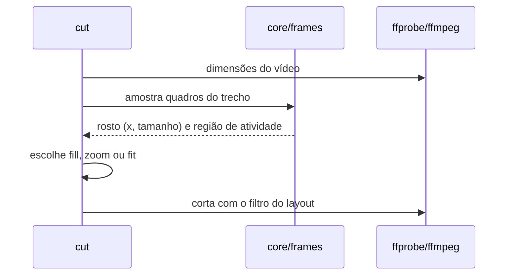

# Critérios — 03 Enquadramento automático do corte

## Modelo do módulo
`completo` para `core/cut.py` e o módulo de análise de quadros.

## Decisões do projeto aplicadas
ADR-0001 (domínio em `core/`, CLI na borda; LLM não vê mídia). Constitution: `SEG-01`, `SEG-03`, `SEG-07`, `ARQ-04`, `ARQ-05`, `ARQ-10`, `DUP-03`, `TST-01`.

## Restrições
- `SEG-03`: ffmpeg/ffprobe por lista de argumentos, via `core/proc.py`.
- `SEG-01`: `--layout` e `--anchor` validados na borda (anchor de 0 a 1).
- `ARQ-04`: OpenCV só no extra `vision`.
- `ARQ-05`: `--dry-run` informa o layout sem escrever em disco.

## O que já existe
| Procurei | Onde | Achei | Decisão | Justificativa |
|---|---|---|---|---|
| Enquadramento 9:16 | `core/cut.py` `ffmpeg_args` | scale + crop central | estender | Mesmo dono (Corte) |
| Sondar dimensões | `core/proc.py` | só `run`/`require_bin` | estender | ffprobe pelo mesmo módulo |
| Análise de quadros | — | nada | criar | `core/frames.py`: rosto e atividade; dono novo em `concepts.md` |

## Dependências novas
`opencv-python-headless`, extra `vision` do uv. Consultar context7 com a versão exata na implementação (`SEG-07`).

## C4: sequência

## Critérios de aceitação executáveis
| # | Critério | Comando |
|---|---|---|
| C1 | Testes e lint passam | `cd engine && uv run pytest && uv run ruff check` |
| C2 | Escolha de layout sem parâmetro (pé, rosto, tela concentrada, tela espalhada, sem OpenCV) | `uv run pytest tests/test_cut.py -k layout` |
| C3 | Anchor fora de 0 a 1 é rejeitado | `uv run pytest -k anchor` |
| C4 | `--dry-run` mostra o layout e não escreve | `uv run reel-studio cut "<gravação>" --theme forge --dry-run` |
| C5 | Gravação real sai 1080×1920 com texto legível (manual) | `uv run reel-studio cut "<gravação>" --theme forge` |
