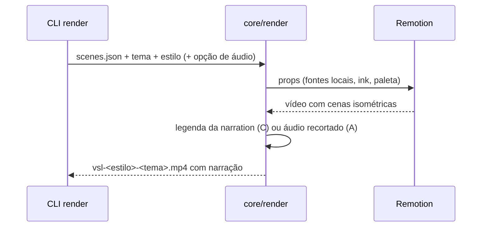

# Critérios — 04 VSL: áudio e estilo visual

## Modelo do módulo
`completo` para o render (`render/`) e para `core/render.py`; `enxuto` para os JSON de estilo.

## Decisões do projeto aplicadas
ADR-0001 (estilo e tema independentes; LLM gera `scenes.json`, nunca código de animação; `SceneRenderer` é o único ponto `type -> componente`). Constitution: `ARQ-05`, `ARQ-06`, `DUP-01`, `DUP-03`, `SEG-07`, `TST-01`.

## Restrições
- `DUP-01`: o `SceneRenderer` continua sendo o único mapa `type -> componente`; variantes por estilo entram num registro, não em `if` espalhado.
- `ARQ-06`: campos novos do estilo (`look.ink`) entram em `contracts/style.schema.json`.
- `ARQ-05`: `render --dry-run` não escreve nada.
- Sem rede no render: as fontes vêm de `render/public/fonts/`.

## O que já existe
| Procurei | Onde | Achei | Decisão | Justificativa |
|---|---|---|---|---|
| Cenas por tipo | `render/src/scenes/*`, `SceneRenderer.tsx` | componentes planos, fontes de 20 a 96 px | estender | Escala tipográfica e variante isométrica |
| Fundo | `background.tsx` | `own` usa `look.bg`; `theme` usa o tema | reusar | `isometric-pastel` passa a `own` |
| Legenda `.ass` | `core/captions.py`, `build_ass` | legenda palavra a palavra por tempo | estender | Gera legenda da `narration` por cena |
| Render | `core/render.py` | sem áudio | estender | Opção de áudio e legenda |

## Dependências novas
`@remotion/fonts` (carregar fontes locais); arquivos de fonte Montserrat (OFL) em `render/public/fonts/`. Consultar context7 com a versão exata (`SEG-07`).

## C4: sequência

## Critérios de aceitação executáveis
| # | Critério | Comando |
|---|---|---|
| C1 | Typecheck do render | `cd render && npx tsc --noEmit` |
| C2 | Estilos e temas validam, incluindo `look.ink` | `cd engine && uv run reel-studio validate` |
| C3 | Testes e lint do motor | `cd engine && uv run pytest && uv run ruff check` |
| C4 | Stills de cada cena: fonte carregada (sem serifa), cobertura vertical e paleta | `cd render && node scripts/check-render.mjs` |
| C5 | O mp4 do VSL tem narração (legenda queimada ou áudio, conforme a decisão) | `ffprobe` e quadros |
| C6 | Manual: VSL do clip-05 no tema forge, quadros de `title`, `flow`, `list`, `highlight` e `cta` | `uv run reel-studio render … --style isometric-pastel --theme forge` |
