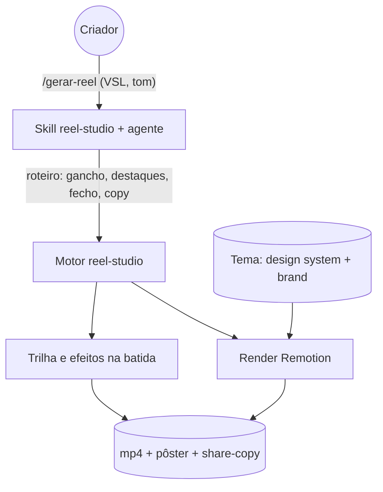
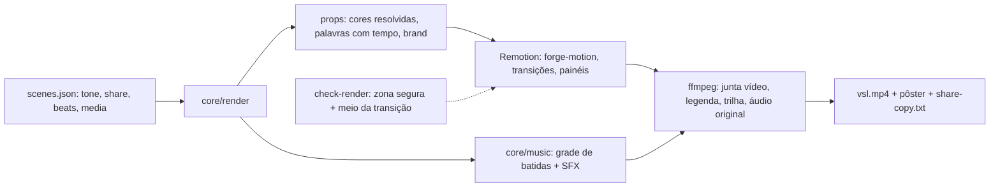

# Critérios — 05 VSL premium

## Modelo do módulo
`completo` para `render/` (movimento, transições, painéis) e para `core/` (roteiro, batida, trilha, entrega); `enxuto` para os JSON de tema e estilo e para a documentação.

## Decisões do projeto aplicadas
ADR-0001 (estilo e tema independentes; o LLM gera `scenes.json`, nunca código de animação; `SceneRenderer` único ponto `type -> componente`; CLI na borda, domínio em `core/`). Iniciativa 04: cores só do tema, estilo só anima. ADR-0002 (`doctor`) está na branch da iniciativa 02, ainda não vigente. Constitution: `SEG-01`, `SEG-03`, `SEG-05`, `SEG-07`, `ARQ-04`, `ARQ-05`, `ARQ-06`, `ARQ-10`, `DUP-01`, `DUP-03`, `TST-01`.

## Restrições
- `DUP-01`: um único mapa `type -> componente`; variantes por estilo no registro `styleScenes`.
- `ARQ-06`: campos novos (`brand` do tema, `tone` e `share` do roteiro, `media` da cena) entram nos schemas em `contracts/`.
- `ARQ-04`: trilha e efeitos só com a biblioteca padrão; sem dependência de render nova; transições próprias, sem `@remotion/transitions`.
- `ARQ-05`: `--dry-run` não escreve nada.
- `SEG-03`: ffmpeg e Node por lista de argumentos. `SEG-05`: dados sensíveis nunca em log, vídeo ou copy.
- Sem rede no render; fontes e ativos locais.

## O que já existe
| Procurei | Onde | Achei | Decisão | Justificativa |
|---|---|---|---|---|
| Render por cena | `render/src/scenes/*`, `SceneRenderer.tsx`, `styleScenes.ts` | 8 tipos de cena, registro de variantes | estender | Novo estilo `forge-motion` entra no registro |
| Placas isométricas | `render/src/iso/` | `IsoSlab` em blocos 3D | reusar | Segue como estilo alternativo |
| Fontes e escala | `fonts.ts`, `scale.ts`, `public/fonts` | Montserrat e JetBrains Mono locais; escala 1080×1920 | reusar | Base de tipografia |
| Fundo | `background.tsx` | cor do tema e brilho radial | estender | Grade e brilho animados |
| Movimento | `motion.ts` | `popIn` e `fadeIn` | estender | Spring, escalonamento e easing do Forge |
| Transição entre cenas | `Reel.tsx` | `Sequence` com corte seco | estender | Transições próprias |
| Tema | `themes/*.json`, `theme.schema.json` | cores, gradiente, brilho, fontes, `logo: null` | estender | Bloco `brand` (logo, mascote, painel, pacote) |
| Cores resolvidas | `core/palette.py`, `core/contrast.py` | token vira hex; contraste WCAG | reusar | Sem cor própria no estilo |
| Legenda | `core/captions.py` | `.ass` da narração | estender | Respeita a zona segura |
| Áudio e `source` | `core/render.py` | áudio original por cena; duração efetiva | estender | Mixagem com a trilha |
| Roteiro | `core/script.py` (`prompt`, `normalize`) | cenas, narração, `source` | estender | Gancho, tom, copy |
| Checagem de quadros | `render/scripts/check-render.mjs` | fonte, escala, cobertura, paleta | estender | Zona segura e quadros do meio da transição |
| Layouts de corte | `core/frames.py`, `core/cut.py` | rosto, atividade, região por densidade | reusar | Recorte do trecho real para o painel |
| Vídeo do Forge | `forge-sdd/docs/video-pipeline/video.html`, `musica.py` | linguagem de movimento e trilha em Python puro | reusar como referência | Identidade do tema; trilha portada para `core/music.py` |
| `/brag` | `latent-spaces/brag` (MIT) | regras de criação e acabamento | adaptar | Ideias, com créditos |

## Dependências novas
Nenhuma. O `musica.py` do Forge usa só a biblioteca padrão de Python. Consultar context7 caso entre qualquer pacote.

## C4: contexto


## C4: contêineres


## C4: sequência
```mermaid
sequenceDiagram
  participant A as Agente
  participant C as CLI
  participant R as Render
  A->>C: prompt-script (tom)
  C-->>A: roteiro pedido: gancho, destaques, fecho, copy
  A->>C: save-scenes (scenes.json)
  C->>C: normalize (zona segura, leitura, batida)
  C->>R: props (tema, brand, palavras com tempo)
  R-->>C: vídeo com transições
  C->>C: junta trilha, áudio e legenda; pôster no quadro 0
  C-->>A: mp4, pôster e share-copy.txt
```

## Critérios de aceitação executáveis
| # | Critério | Comando |
|---|---|---|
| C1 | Testes e lint do motor | `cd engine && uv run pytest && uv run ruff check` |
| C2 | Typecheck do render | `cd render && npx tsc --noEmit` |
| C3 | Conteúdo lido dentro da zona segura (y 250 a 1536; fora dos 140 px da direita embaixo), com sobreposição das faixas | `cd render && node scripts/check-render.mjs --safe-zone` |
| C4 | Quadros do meio da transição, tirados da linha do tempo, sem dupla exposição e sem sobreposição de texto | `cd render && node scripts/check-render.mjs --transitions` |
| C5 | Tempo de leitura mínimo (0,3 s por palavra) e cortes na grade de batidas | `cd engine && uv run pytest -k "leitura or batida"` |
| C6 | `ffprobe`: pôster no quadro 0, trilha e áudio original, duração igual a frames/fps | `ffprobe` e `ffmpeg` sobre o mp4 |
| C7 | Tema novo ou estilo sem `brand` continua renderizando (compatibilidade) | `uv run pytest -k brand` |
| C8 | Manual: VSL do clip-05, tema forge, estilo `forge-motion`, comparado com o vídeo do pipeline | `uv run reel-studio render … --style forge-motion --theme forge` |
