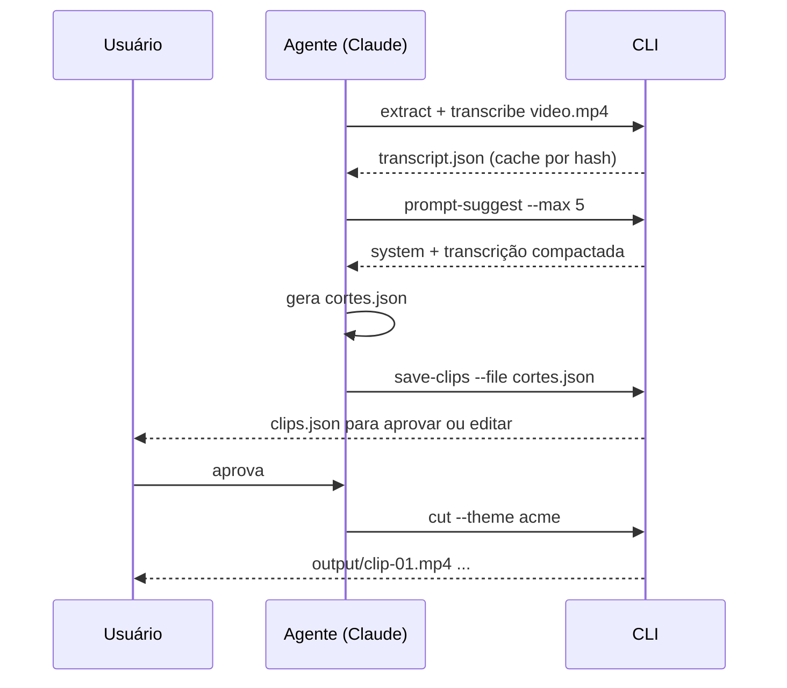
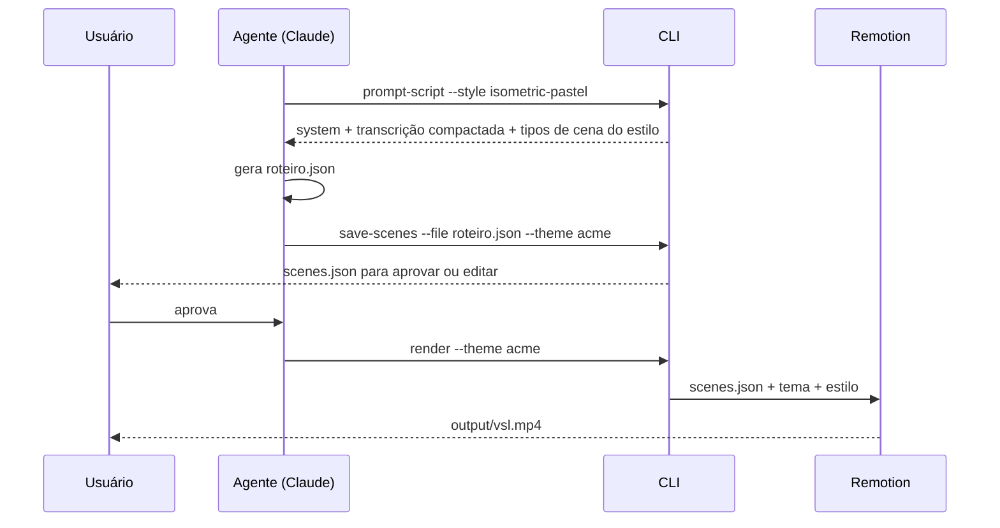

# Fluxos — reel-studio

## Modo corte (vídeo bom, dentro do Claude Code)

## Modo VSL (vídeo ou áudio ruim, dentro do Claude Code)

## Caminho de automação (sem agente: CI, cron)
`suggest`/`script` substituem `prompt-*`/`save-*` e chamam o OpenRouter direto, com `OPENROUTER_API_KEY`.
