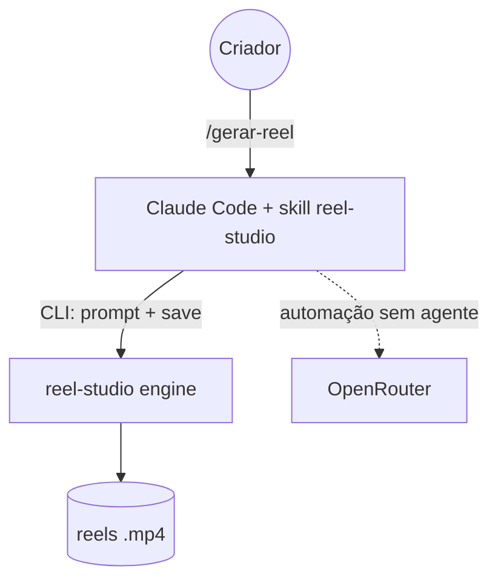
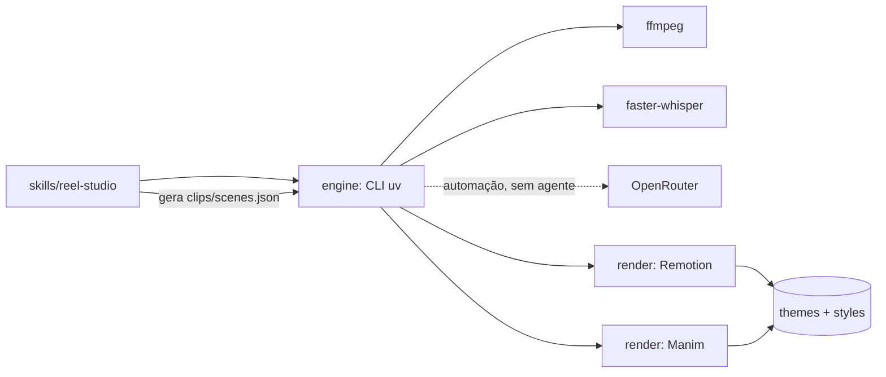

# Overview — reel-studio

Plugin do Claude Code com motor local que transforma vídeos gravados em reels 9:16. Dois modos: **corte** (recorta o vídeo real, com legenda na marca) e **VSL** (reescreve como roteiro curto e anima em um dos estilos). Dentro do Claude Code, o próprio agente gera os cortes e o roteiro a partir da transcrição, sem chamada de rede nova; o OpenRouter é só o caminho de automação sem agente.

## Índice
- `stack.md` — tecnologias
- `modules.md` — componentes
- `flows.md` — fluxos principais
- `decisions.md` — decisões de design
- `concepts.md` — dono de cada conceito
- `adr/adr-0001-arquitetura-base.md` — decisões base

---

## Arquitetura (C4 Model)

### Nível 1: Contexto

### Nível 2: Containers

